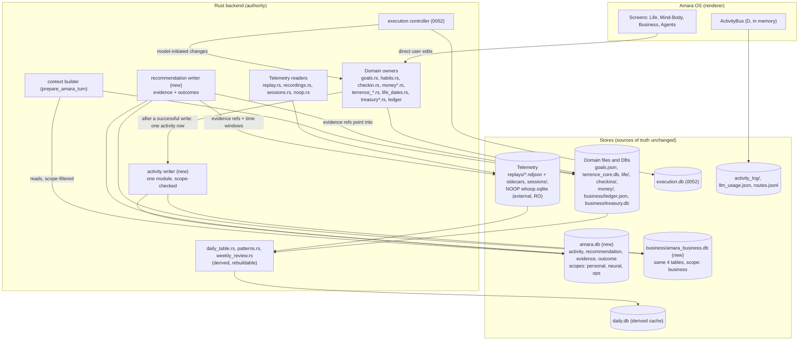
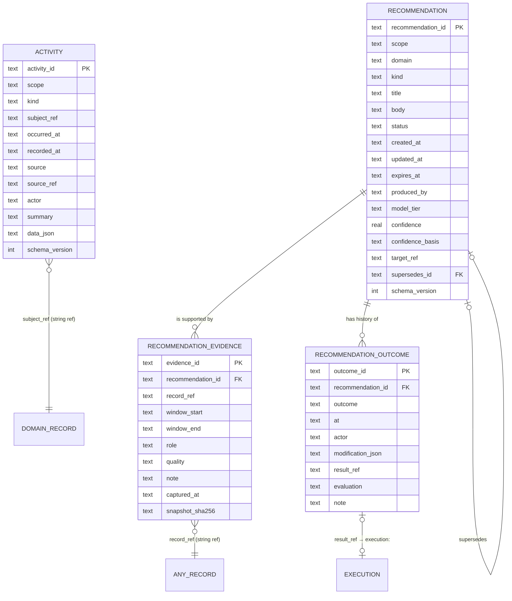

# Shared data architecture for Nexus and Amara (proposal, decision 0053)

**Status:** design only, **awaiting Taisun's approval.** No table has been created and nothing has been migrated.
**Inspected:** 2026-11-25, against the code at `d1b9e5e` and the live data folder `~/Library/Application Support/com.taisun.nexus/`. File names, table names and key names were read; no personal values were read.

## 0. Summary

- **Keep every existing source of truth where it is.** Each domain already has one owner module and one file. Moving them buys nothing and risks data.
- **Add one new store with four tables:** `activity`, `recommendation`, `recommendation_evidence`, `recommendation_outcome`. It's for what doesn't exist today: personal activity history (C), recommendations (E) and their outcomes (F), with evidence that points at exact records and time windows.
- **Two physical files, one per isolation boundary:**
  - `<data>/amara.db`: personal, neural and shared-operational scopes;
  - `<data>/business/amara_business.db`: business scope.

  Same schema in both.
- **Fix, don't replace:** `goals.json` gets locked, atomic writes and stops treating a parse failure as empty.
- **Retire nothing yet:**
  - `events.db` stops gaining new generic writers: it was never the telemetry store and must not become a domain store.
  - The ActivityBus stays operational-only.
- **References between stores use one string format** (§3.1), so evidence can point anywhere without foreign keys across files.

## 1. What exists today (inspected)

### 1.1 Inventory by kind

| Kind | Store | Format | Owner (writer) | Notes |
|---|---|---|---|---|
| **A. Domain** | `goals.json` | JSON list | `goals.rs` (+ `adds`, `goal_venture`, `habits`, `needs_you`) | 6 goals; keys `id, title, category, target, current, unit, deadline, created_at, updated_at`; habits are `category:"habit"`. Not atomic, no lock, parse failure becomes `[]` |
| A | `goals/roadmaps.json`, `goals/branches.json` | JSON | `goal_roadmap.rs`, `goal_route.rs` | versioned (`version` key) |
| A | `habits/days.json` | JSON | `habits.rs` | habit completions per day (not created yet on this Mac) |
| A | `terrence_core.db`: `terrence_projects`, `terrence_priority_items`, `terrence_decisions`, `terrence_actions`, `terrence_automations`, `context_items` | SQLite WAL | `terrence_*.rs` | projects, priorities, decisions, model actions, automations, context memory |
| A | `life/dates.json` | JSON | `life_dates.rs` | Dates & Deadlines |
| A | `checkins/checkins.json` | JSON | `checkin.rs` | mood/energy check-ins |
| A | `money/entries.jsonl` (+ `accounts/balances/fx/watch.json`) | JSONL/JSON | `money*.rs` | personal money; `amount_minor, currency, date, kind, source` |
| A (business) | `business/ledger.json` | JSON | `business_ledger.rs` | ventures, funds, FX, funding requests, tax flags, votes, revenue target |
| A (business) | `business/treasury.db` | SQLite | `treasury*.rs` | income events, streams, imports, sequences, reviews, flags |
| A (business) | `events.db`: `arm_decisions`, `arm_strategies` | SQLite | `arm.rs` | ARM trading |
| A | `subagents.json`, `workspace/skills`, `workspace/skill_versions` | JSON/MD | `subagents.ts`, `openclaw.rs`, `skills_lifecycle.rs` | |
| A | `chat_history.db` (`chat_sessions`, `chat_messages`), `terrence_interactions/` | SQLite / JSON files | `chat_history.rs`, `terrence_runtime.rs` | conversations |
| **B. Telemetry** | `replays/*.ndjson` (+ `.bands.json` sidecars) | NDJSON | `replay.rs`, `recordings.rs` | 29 EEG recordings, 214 MB. **Sacred, read-only** |
| B | `sessions/muse_*.json` | JSON | `sessions.rs` | 54 session summaries |
| B | `muse/` (capture, GATT logs) | JSONL/log | `muse.rs` | raw capture diagnostics |
| B (external) | NOOP `OpenWhoop/whoop.sqlite` | SQLite, read-only | NOOP | HR, HRV, RR, sleep, workouts. Nexus never writes it |
| B | `events.db`: `events` | SQLite | `events.rs` (ARM only today) | ~40 rows: snapshot and Muse summary metrics and 4 `goal/current` rows. Not the real telemetry store |
| B (derived) | `daily.db`: `daily`, `daily_goal` | SQLite | `daily_table.rs` | one row per day, rebuilt from the stores; `sources` column |
| **C. Activity history** | none dedicated | | | The pieces exist inside domain stores (habit days, check-ins, goal `updated_at`, workout rows in NOOP, `adds/history.json` edit History) |
| **D. Operational** | ActivityBus (renderer memory) + `activity_log/` (1,812 JSON files, 7.4 MB, 30-day retention) | JSON | `activityBus.ts`, `continuity.rs` | scheduler jobs, health checks |
| D | `execution.db` | SQLite | `execution/` (0052) | state-changing operations ledger |
| D | `llm_usage.json` (252 KB), router `routes.jsonl`, `outbox` (11 rows), `screen_opens.db`, `notifications.json`, `proactive_state.json` | mixed | various | |
| **E/F. Recommendations** | `takes/take_log.jsonl`, `takes/take_events.jsonl`, `kv/amara_take_*.json` | JSONL/JSON | `take_log.rs`, `amaraTake/` | Amara's "takes": shown, rated, helpful. The only recommendation and outcome data today, with no evidence links |
| E (derived) | `patterns/patterns.json`, `weekly_review/review.json` | JSON | `patterns.rs`, `weekly_review.rs` | computed findings with windows and counts |
| **Continuity** | `terrance_context.json`, `session_logs/` (99 files), `archive/` | JSON | `continuity.rs` | goals primer, last summary, session summaries |
| **Config** | `config.json` (+ `.bak`), `backup_settings.json`, `onboarding.json`, `kv/` | JSON | `telegram.rs` (NexusConfig), others | Secrets in Keychain or 0600 files, not here |

### 1.2 External databases (outside the data folder)

| System | Holds | Nexus access |
|---|---|---|
| Letta (Docker, Postgres-backed) | persona/human core memory blocks | read (`memory_read.rs`); write only through the approval dialog (`memory_write.rs`) |
| Weaviate + Verba | 8 knowledge-base documents (vector index) | query via n8n `kb.query` |
| n8n Postgres (`n8n_db`) | workflows, executions | none directly |
| NOOP SQLite | health telemetry | read-only (`noop.rs`, `noop_query.rs`) |
| Hermes (`~/.hermes`) | its own sessions and state | none (Nexus talks to Hermes over HTTP) |
| Amara Router | `routes.jsonl` (no content) | read for the route badge |

### 1.3 Problems this design must solve

1. Personal activity history (C) doesn't exist as such. The ActivityBus is operational (D) and must not be stretched into it.
2. Recommendations (E) have no evidence, so no recommendation can say which records and periods support it.
3. Outcomes (F) exist only for takes (`rated/helpful`). There's no "accepted, modified, completed, evaluated".
4. `goals.json` integrity: no lock, not atomic, parse failure treated as empty. Stale copies sit in `context_items` and `events.db`.
5. `events.db`'s role is ambiguous: called "canonical event store", but in practice used by ARM and the outbox.
6. Business data is already in its own folder; the new tables must not break that.

## 2. Architecture



**Rules the diagram encodes:**
- Domain owners stay the only writers of their files.
- `activity` rows are written by the domain owner right after its own successful write, never by the UI or the model directly.
- Telemetry is never copied into the new tables. Evidence points at it by reference and time window.
- `daily.db`, patterns and the weekly review stay derived and rebuildable: never a source of truth.
- The ActivityBus and `activity_log/` stay operational (D).

## 3. Proposed schema (the smallest useful one)

### 3.1 Record references (no new table)

One string format names any record anywhere:

```
<store>:<record-id>[@<version>][#<window>]
```

| Example | Meaning |
|---|---|
| `goals:g-1730000000-ab12` | a goal in `goals.json` |
| `habit_day:g-…-ab12:2026-11-20` | one habit completion day |
| `checkin:c-…` | a check-in |
| `money:m-…` | a personal money entry |
| `project:p-…` / `action:a-…` / `decision:d-…` | rows in `terrence_core.db` |
| `noop:daily:2026-11-20` / `noop:workout:<id>` | NOOP rows (external) |
| `replay:eeg_20261106_073914#t=120..300` | seconds 120–300 of one EEG recording |
| `session:muse_<uuid>` | a Muse session summary |
| `daily:2026-11-20` | a derived day row (as a *calculation*, never an observation) |
| `treasury:income:<id>` / `ledger:venture:<id>` | business records (business scope only) |
| `execution:<execution_id>` | a ledger entry (0052) |

A small Rust module (`record_ref.rs`) parses and resolves these. Resolving reads the owning store, so a dangling reference is detectable: it reports `missing`, never a guess.

### 3.2 Entity-relationship diagram



`DOMAIN_RECORD`, `ANY_RECORD` and `EXECUTION` are records in other stores, linked by reference strings (§3.1), not foreign keys.

### 3.3 Tables

All four live in `amara.db`, and again in `business/amara_business.db` for business scope. Timestamps are RFC 3339 UTC text, as in `execution.db`. Each file also has `schema_meta(key, value)` holding `schema_version = 1`, and a newer version is refused (same rule as `execution.db`).

#### `activity`: personal activity history (C)

| Field | Type | Req | Notes |
|---|---|---|---|
| `activity_id` | TEXT PK | ✓ | UUID v4 |
| `scope` | TEXT | ✓ | `personal` \| `neural` \| `ops` (amara.db); `business` (business file). CHECK constraint per file |
| `kind` | TEXT | ✓ | closed vocabulary in Rust: `habit.completed`, `habit.missed`, `goal.progressed`, `goal.milestone_reached`, `goal.completed`, `project.updated`, `checkin.logged`, `workout.finished`, `neuro.session_finished`, `date.done`, `money.logged`, `business.action_done`, … |
| `subject_ref` | TEXT | ✓ | what it is about (`goals:…`, `project:…`) |
| `occurred_at` | TEXT | ✓ | when it happened (may be backdated: a habit ticked for yesterday) |
| `recorded_at` | TEXT | ✓ | when the row was written |
| `source` | TEXT | ✓ | `user` \| `model` (through the controller) \| `scheduler` \| `import` \| `backfill` \| `noop` |
| `source_ref` | TEXT | | the exact record or execution that caused it (`execution:…`, `history:…` from `adds`) |
| `actor` | TEXT | ✓ | `taisun` \| `amara` \| `system` |
| `summary` | TEXT | | short fixed-template text, no free model text |
| `data_json` | TEXT | | small structured payload (e.g. `{"from":3,"to":4,"unit":"sessions"}`); ≤ 4 KB; no telemetry series |
| `schema_version` | INT | ✓ | 1 |

- **Unique** `(kind, subject_ref, occurred_at, source)`: replays and backfills are idempotent.
- **Append-only:** triggers refuse UPDATE. A correction is a new row of kind `<kind>.corrected` with `source_ref` pointing at the original. DELETE is allowed only through the retention job and the "forget this" path (§6).
- **Retention:** personal and business kept until deleted by Taisun. Neural activity rows follow the session or recording they describe. Ops rows: 90 days.

#### `recommendation` (E)

| Field | Type | Req | Notes |
|---|---|---|---|
| `recommendation_id` | TEXT PK | ✓ | UUID v4 |
| `scope` | TEXT | ✓ | as above. **Personal and neural may combine; business never combines with either** (§6) |
| `domain` | TEXT | ✓ | `life` \| `fitness` \| `neuro` \| `money` \| `enterprise` \| `cross` |
| `kind` | TEXT | ✓ | `goal_adjustment`, `training_suggestion`, `habit_nudge`, `business_opportunity`, `take`, … |
| `title`, `body` | TEXT | ✓ | what was shown |
| `status` | TEXT | ✓ | `proposed` → `shown` → `accepted` \| `modified` \| `dismissed` \| `expired` → `completed` → `evaluated`. Current state only; the history is in `recommendation_outcome` |
| `created_at`, `updated_at` | TEXT | ✓ | |
| `expires_at` | TEXT | | after this, `expired` (never acted on silently) |
| `produced_by` | TEXT | ✓ | `rules:<detector id>` \| `model:<purpose>` (the 0051 inference purpose label) \| `user` |
| `model_tier` | TEXT | | `light`/`deep`/`claude` (never a model name) |
| `confidence` | REAL | | 0–1, **only when it is calculated**; NULL when there's no basis. Never shown as a precise number unless the basis allows it |
| `confidence_basis` | TEXT | | `n=12 days; mean diff 8%` or `heuristic`. Required when `confidence` is set |
| `target_ref` | TEXT | | the record it proposes to change (`goals:…`) |
| `supersedes_id` | TEXT FK | | a revised recommendation points at the one it replaces |
| `schema_version` | INT | ✓ | 1 |

- **Rule (CHECK in Rust before insert):** a recommendation with `kind != 'take'` needs at least one evidence row with `role = 'observation'`.
- **Retention:** kept with its evidence and outcomes for evaluation. Deleting one deletes its evidence and outcomes (ON DELETE CASCADE).

#### `recommendation_evidence`

| Field | Type | Req | Notes |
|---|---|---|---|
| `evidence_id` | TEXT PK | ✓ | UUID v4 |
| `recommendation_id` | TEXT FK | ✓ | ON DELETE CASCADE |
| `record_ref` | TEXT | ✓ | §3.1, exact record (and version if the store has one) |
| `window_start`, `window_end` | TEXT | | the exact period used (required for telemetry and daily refs) |
| `role` | TEXT | ✓ | `observation` (a measured or logged fact) \| `calculation` (derived: daily row, pattern) \| `hypothesis` (the model's interpretation). Keeps the "observations vs calculations vs hypotheses" rule |
| `quality` | TEXT | ✓ | `measured` \| `estimate` (e.g. PPG HR, `estimate:true`) \| `self_report` \| `partial` (gaps in window) \| `missing` (the absence itself is the evidence; **never zero-filled**) |
| `note` | TEXT | | short, fixed vocabulary where possible |
| `captured_at` | TEXT | ✓ | when the evidence was read |
| `snapshot_sha256` | TEXT | | hash of the values as read, so a later change to the source is detectable without copying personal values |

- **Index:** `(recommendation_id)`, `(record_ref)`. The second answers "what did this record support?" and is used to delete evidence if a record is forgotten.
- **Scope:** the evidence's record must be in the recommendation's scope or an allowed one (§6). Checked in Rust; resolving a ref also checks its scope.

#### `recommendation_outcome` (F)

| Field | Type | Req | Notes |
|---|---|---|---|
| `outcome_id` | TEXT PK | ✓ | UUID v4 |
| `recommendation_id` | TEXT FK | ✓ | ON DELETE CASCADE |
| `outcome` | TEXT | ✓ | `shown` \| `accepted` \| `modified` \| `dismissed` \| `expired` \| `completed` \| `evaluated` |
| `at` | TEXT | ✓ | |
| `actor` | TEXT | ✓ | `taisun` \| `amara` \| `system` |
| `modification_json` | TEXT | | for `modified`: what Taisun changed (field-level) |
| `result_ref` | TEXT | | what acting on it produced: `execution:<id>` (0052) or a domain ref |
| `evaluation` | TEXT | | for `evaluated`: `helped` \| `no_effect` \| `worse` \| `unknown`, plus `evaluation_basis` in `note` |
| `note` | TEXT | | |

- **Append-only** (triggers refuse UPDATE and DELETE, except through the cascade).
- `recommendation.status` is updated in the same transaction (compare-and-swap, as in the 0052 ledger).

### 3.4 What is deliberately NOT a new table

| Not created | Why |
|---|---|
| A generic "records" or "entities" table | Domain stores already own their records; a second copy is a second source of truth |
| Telemetry tables | Telemetry stays in replays, sessions and NOOP. Evidence points at it with a time window |
| Tasks, projects, goals tables | `terrence_projects`, `goals.json` already exist |
| User-logged workouts | Phase 9 designs that store with its reconciliation against NOOP |
| Imagined-speech research data | Phase 14 gets its own dataset folder and manifest (§6, neural research) |
| A unified operational log | ActivityBus, `activity_log/` and `execution.db` already cover D |

## 4. Source-of-truth matrix

| Data | Source of truth | Only writer | Copies (all non-authoritative) | Scope | Retention |
|---|---|---|---|---|---|
| Goals, habit definitions | `goals.json` | `goals.rs` (other modules through its functions) | `context_items` import (one-way refresh), `terrance_context.json` primer, `events.db` `goal/current` rows (legacy, frozen) | personal | until deleted (History/Undo) |
| Habit completions | `habits/days.json` | `habits.rs` | `daily.db`, `activity` rows | personal | until deleted |
| Roadmaps and branches | `goals/roadmaps.json`, `goals/branches.json` | `goal_roadmap.rs`, `goal_route.rs` | | personal | until deleted |
| Projects, priorities, decisions, model actions | `terrence_core.db` | `terrence_*.rs` | context sections | personal | as today |
| Dates & Deadlines | `life/dates.json` | `life_dates.rs` | context section | personal | as today |
| Check-ins | `checkins/checkins.json` | `checkin.rs` | `daily.db` | personal | as today |
| Personal money | `money/entries.jsonl` (+ accounts) | `money*.rs` | context section | personal | as today |
| Ventures, funds, FX, targets | `business/ledger.json` | `business_ledger.rs` | | business | as today |
| Business income | `business/treasury.db` | `treasury*.rs` | | business | as today |
| ARM trading | `events.db` `arm_*` + ARM `events` rows | `arm.rs` | | business | as today |
| Conversations | `chat_history.db`, `terrence_interactions/` | chat, runtime | turn summaries | personal | as today |
| Session summaries (memory) | `session_logs/` → `archive/` | `continuity.rs` | Letta (approved writes only) | personal | 30 days live, then archived |
| Context memory | `context_items` (`terrence_core.db`) | `terrence_context.rs` | | personal | as today |
| Letta core blocks | Letta | Letta (Nexus writes only through approval) | | personal | external |
| EEG recordings | `replays/*.ndjson` (+ sidecars) | `replay.rs` (write once) | `sessions/`, `daily.db` | neural | **never modified**; deleted only by Taisun |
| Muse session summaries | `sessions/` | `sessions.rs` | `daily.db`, `activity` | neural | as today |
| HR, HRV, RR, sleep, detected workouts | NOOP `whoop.sqlite` | NOOP | `daily.db`, evidence refs | personal (health) | external |
| Daily table | derived | `daily_table.rs` | | personal | rebuildable, may be dropped |
| Patterns, weekly review | derived files | `patterns.rs`, `weekly_review.rs` | | personal | rebuildable |
| **Activity history** | **`amara.db` / `amara_business.db` `activity`** (new) | activity module (called by domain owners) | | per row | §3.3 |
| **Recommendations, evidence, outcomes** | **same files** (new) | recommendation module | takes (`take_log.jsonl`) stay as the takes UI log until migrated (§5 step 4) | per row | §3.3 |
| State-changing executions | `execution.db` | controller (0052) | | ops | until a retention policy is set (proposed: 1 year) |
| Operational job log | ActivityBus + `activity_log/` | renderer + `continuity.rs` | | ops | 30 days, then monthly archive |
| LLM usage | `llm_usage.json` | `llm_router.rs` (locked) | | ops | last 1,000 records |
| Config | `config.json` + Keychain/0600 secret files | `telegram.rs` save path | `.bak` files | ops | as today |
| Skills | `workspace/skills` (live), `workspace/skill_versions` (history) | `skills_lifecycle.rs` | | ops | versions kept |

## 5. Migration plan

The schema adds two new files and changes no existing format. "Migration" here means creating the new stores, fixing goal writes, and optionally backfilling activity from records that already exist.

### Step 0: before anything (each step below)

1. **Full backup** through the existing backup path (`run_backup`). The new files are added to it with `VACUUM INTO`, as `execution.db` already is.
2. **Pre-change copy** of every file a step touches into `<data>/migrations/<version>-<timestamp>/` (0600). The first touched file is `goals.json`.
3. Record the step in `<data>/migrations/log.jsonl`: version, step, file hashes before and after, result.

### Step 1: create the stores (schema v1)

- `CREATE TABLE IF NOT EXISTS …` in both files, inside one transaction per file. Write `schema_meta.schema_version = 1`.
- A newer version on disk is refused; the app keeps working without the new features.
- **Idempotent:** running it twice changes nothing.
- **Rollback:** delete the two new files. No existing store referred to them.

### Step 2: make `goals.json` safe (existing goal preservation)

- Writes go through `local_store::write_json_atomic` under a process lock, re-read after write. This is the same pattern as the other JSON stores.
- **A parse failure is an error, not `[]`.** The file is copied to `goals.json.unreadable-<ts>` and the app shows "Goals couldn't be read", never an empty list that a save would then overwrite.
- No format change: the same keys, so older builds still read it.
- **Test:** a corrupt `goals.json` is never overwritten; concurrent writes don't lose goals.
- **Rollback:** the code change only; the file is untouched.

### Step 3: one-way goal copies

- The `context_items` goal import becomes a refresh from `goals.json`, never the other way.
- `events.db` `goal/current` rows are frozen: no new writer, kept for history.

### Step 4: start writing activity and recommendations (forward only)

- Each domain owner calls `activity::record(...)` after its successful write (habits, goals, check-ins, dates, projects, Muse sessions, NOOP workouts when first seen).
- Takes start writing `recommendation` plus `outcome` rows alongside `take_log.jsonl`. Once the UI reads the new tables, `take_log.jsonl` becomes read-only history.

### Step 5 (optional, needs your OK): backfill

- Derive `activity` rows from existing records: habit days, check-ins, goal timestamps, Muse sessions, NOOP workouts.
- Use `source = 'backfill'` and `occurred_at` from the source record. The unique key makes it idempotent.
- No source record is modified. Re-running is safe.
- **Rollback:** `DELETE FROM activity WHERE source='backfill'`.

### Preservation guarantees

| Data | Guarantee |
|---|---|
| Goals | `goals.json` stays the file; pre-change copy; never replaced by an empty list; format unchanged |
| Events | `events.db` untouched (no schema change, no deletes). Only new generic writers are refused |
| Sessions and recordings | read-only; never moved, rewritten or re-encoded (`muse-recordings.md`) |
| Everything else | no file changes shape; new data goes only to the two new files |

### Schema versioning (all new and future stores)

- A `schema_meta` table (SQLite) or a `version` key (JSON).
- Additive changes only within a major version.
- A migration is a numbered Rust function that runs inside a transaction, after a pre-change copy, and is logged.
- **Downgrade:** a newer schema is refused, never "repaired".

## 6. Permission model

**Actors:**
- **user**: Taisun in the app;
- **model**: anything a model proposes, going through the 0052 controller;
- **scheduler**: background jobs;
- **integration**: Hermes, n8n, crews and Telegram, which reach Nexus only through its own tools;
- **export**: backups and cloud context.

| Scope | Holds | User | Model | Scheduler | Integration | Cloud LLM context | Backup |
|---|---|---|---|---|---|---|---|
| **personal** | goals, habits, check-ins, money, health, conversations, activity, personal recommendations | read/write | read via context builder; writes only through the controller with approval (0052) | derive (daily, patterns, review), write activity and recommendations | only the tools already granted (follow-ups, inbox) | **off by default**; health and money never (existing local-only pins) | yes |
| **business** | ledger, treasury, ARM, business activity and recommendations | read/write | read only inside Enterprise; writes through the controller | derive | none until Phase 11 connectors | off by default | yes |
| **neural** | EEG recordings, sidecars, Muse sessions, neural activity and recommendations | read; delete only | read summaries and bands, **never raw samples** | derive bands and summaries | none | **never** | yes (recordings already are) |
| **ops** (shared, non-sensitive) | job runs, health checks, executions, usage, route log | read | none | write | none | no | yes |

**Rules enforced in Rust:**
1. **Scope crossing:**
   - A `cross`-domain recommendation may use personal and neural evidence only.
   - Business evidence never supports a personal recommendation, and the reverse.
   - Checked when evidence is attached.
2. **Context builder:** neural data enters a prompt only as summaries the user has seen in the app (bands, minutes, ratings), never raw samples, and never on the cloud tier.
3. **"Forget this":** deleting a domain record also deletes the `activity` rows whose `subject_ref` matches and evidence rows whose `record_ref` matches. A recommendation left without observations is marked `expired` with note `evidence_deleted`.
4. **Exports:** backups include all scopes (local, 0600). Any future export by scope must ask per scope.

## 7. Risks and trade-offs

| Risk / trade-off | Choice and why |
|---|---|
| String refs instead of foreign keys | Records live in ~20 stores and 3 formats; cross-file foreign keys are impossible. **Mitigation:** one parser/resolver, `missing` reported honestly, a weekly integrity check that lists dangling refs |
| Two new files vs one | Business isolation is a stated rule, and a separate file makes it physical. **Cost:** schema kept in sync in two places (one Rust module creates both) |
| Neural not in its own file | The new tables hold only references and short summaries about neural data; the raw data already lives apart (`replays/`). **Revisit** for Phase 14 research datasets, which get their own folder and manifest |
| Activity written by domain owners (a call in each) vs a watcher | A watcher would infer events from file diffs (fragile). Explicit calls are reliable but must be added module by module. Tests pin each one |
| `events.db` left as is | Retiring or renaming it risks ARM and the outbox. Freezing new generic writers stops the confusion at no cost |
| Takes running in parallel with recommendations | A temporary double write until the UI moves; `take_log.jsonl` then becomes read-only. Small, bounded |
| `confidence` misuse | NULL unless calculated, with a required `confidence_basis`; the UI must say "estimate" where the quality is `estimate` (existing rule) |
| Backfill quality | Old records may lack exact times. `occurred_at` uses what the record has, with `data_json.precision = "day"` where only a date exists. Backfill stays optional |
| Growth | Activity: tens of rows a day (small). Evidence: a handful per recommendation. Ops retention bounds the rest. No telemetry is duplicated |
| Phase ordering | Phases 3 and 4 shipped before this design. `execution.db` fits it as the ops-scope execution store; no change needed |

## 8. Approval needed

1. Approve the **two files and four tables** (§3), or choose one file with a scope column.
2. Approve **Step 2** (`goals.json` atomic, locked, no empty-on-parse-failure) as the first implementation step.
3. Decide whether to run the **optional backfill** (§5 step 5).
4. Confirm the **permission table** (§6), especially "neural never on the cloud tier" and "business never mixed with personal".

Nothing in this document has been implemented.
